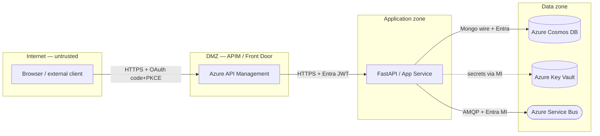

# Skill — Microsoft Threat Model (Azure)

Produce a STRIDE threat model for any codebase that uses Azure
resources, grounded in Microsoft's official **Azure Cloud Services**
Threat Modeling Tool template (`Azure Cloud Services.tb7`,
`Manifest@id=11111111-1111-1111-1111-111111111111`,
author *Microsoft C+AI Security*). The output is a Markdown document
suitable for security review (the same shape as the existing
`docs/ThreatModel.md`).

Use this skill when the user asks for:

- "create a threat model" / "STRIDE analysis" / "security review" of an
  Azure-based application;
- a follow-up on `docs/ThreatModel.md` (extend, refresh, add a resource);
- compliance evidence (SOC 2 / ISO 27001 / RAI) requiring documented
  threat enumeration + mitigations + residual risk per Azure resource.

---

## 1. What you must produce

A single Markdown file (default path: `docs/ThreatModel.md`) with these
sections, in order:

1. **System overview** — 3–6 sentences describing the application, its
   purpose, and the data classification it handles
   (Public / Internal / Confidential / Highly Confidential / Restricted).
2. **Architecture & data flow** — a Mermaid `flowchart` diagram + a
   bulleted description of each component, data flow, and trust
   boundary. Trust boundaries cross from less-trusted to more-trusted
   zones (Internet → DMZ → Application → Data).
3. **Asset inventory** — table of every Azure resource (`Name`,
   `Stencil`, `Sensitivity`, `Trust zone`, `Notes`).
4. **STRIDE threat enumeration** — one subsection per element, six
   rows (S, T, R, I, D, E) with: Threat, Source (template Threat ID),
   Severity (Critical / High / Medium / Low), Status
   (Mitigated / Partially Mitigated / Open / N/A), Mitigations,
   Residual risk.
5. **Cross-cutting controls** — identity, network, secrets, monitoring,
   data-at-rest / in-transit, supply chain.
6. **RAI / TRIP** *(only when the system uses AI/ML)* — Transparency,
   Reliability & safety, Inclusivity, Privacy.
7. **Verification matrix** — for every mitigation, a row pointing to
   the code path, test, or runtime check that proves it.
8. **Open risks & follow-ups** — anything in §4 marked
   *Open* or *Partial*, with owner and target date.

---

## 2. Inputs you collect from the user / repo

If anything is missing, **ask once** at the start with a short multiple
choice (do not bombard the user with one question at a time):

- **App scope** — repo paths to include; entry points (HTTP/MCP/queue
  triggers); auth surfaces.
- **Resource list** — every Azure resource the app talks to. If the
  repo has an `infra/`, `bicep/`, `terraform/`, `azure.yaml`,
  `docker-compose.yml`, `.env*`, or `Settings` file, infer from those
  first and confirm with the user.
- **Data classification** — Public / Internal / Confidential / Highly
  Confidential / Restricted, and whether the system processes PII /
  PHI / payment data / EU personal data.
- **Trust boundaries** — typically Internet, DMZ (APIM / Front Door),
  Application (FastAPI / App Service), Data (Cosmos, Storage,
  Service Bus, Key Vault). Confirm if non-standard.
- **AI/ML usage** — does the system call LLMs / agents / Cognitive
  Services? If yes, the RAI / TRIP section is mandatory.
- **Existing controls to assume** — Entra ID + DefaultAzureCredential,
  TLS 1.2+, Defender for Cloud, Key Vault, private endpoints, etc.

---

## 3. Map each Azure resource to its template stencil

The template ships **22 first-class Azure stencils**. Use this table to
pick the right stencil for each resource the app uses. Anything not in
the table maps to `Generic Process` / `Generic Data Store` /
`Generic External Interactor` with the closest matching stencil's
threat set carried over.

| Stencil name (template) | Template element id | Common Azure resources it represents |
|---|---|---|
| Azure AD | `SE.P.TMCore.AzureAD` | Entra ID tenants, app registrations, managed identities |
| Azure App Service Web App | `SE.P.TMCore.AzureAppServiceWebApp` | App Service (Web), Static Web Apps |
| Azure App Service API App | `SE.P.TMCore.AzureAppServiceApiApp` | App Service (API), FastAPI/Express on App Service |
| Azure App Service Mobile App | `SE.P.TMCore.AzureAppServiceMobileApp` | Mobile back-ends on App Service |
| Azure Cosmos DB | `SE.P.TMCore.AzureDocumentDB` | Cosmos DB (SQL/Mongo/Cassandra/Table/Gremlin), Mongo vCore |
| Azure Data Explorer | (generic process / data store) | Kusto clusters |
| Azure Data Factory | (generic process) | ADF pipelines |
| Azure Database for MySQL | `SE.DS.TMCore.AzureMySQLDB` | Azure DB for MySQL flexible/single server |
| Azure Database for PostgreSQL | `SE.DS.TMCore.AzurePostgresDB` | Azure DB for PostgreSQL flexible/single server |
| Azure Event Hub | `SE.P.TMCore.AzureEventHub` | Event Hubs namespaces, Kafka-compatible endpoint |
| Azure IaaS VM Trust Boundary | (trust boundary) | VMs, VMSS, AKS node pools |
| Azure Key Vault | `SE.DS.TMCore.AzureKeyVault` | Key Vault standard/premium |
| Azure Logic Apps | (generic process) | Logic Apps (consumption/standard), Power Automate flows |
| Azure ML | (generic process) | Azure ML workspaces, AML endpoints |
| Azure Redis Cache | `SE.P.TMCore.AzureRedis` | Azure Cache for Redis, Azure Managed Redis |
| Azure SQL Database | `SE.DS.TMCore.AzureSQLDB` | Azure SQL DB, SQL MI |
| Azure SQL Data Warehouse | `SE.DS.TMCore.AzureSQLDWDB` | Synapse Dedicated SQL Pool |
| Azure Storage | `SE.DS.TMCore.AzureStorage` | Blob, Queue, Table, File storage |
| Azure Stream Analytics | (generic process) | ASA jobs |
| Azure Traffic Manager | `SE.P.TMCore.AzureTrafficManager` | Traffic Manager, Front Door (DNS-only mode) |
| Azure Trust Boundary | (trust boundary) | Subscription / resource-group boundary |
| Azure Web Job | (generic process) | WebJobs, Functions hosted on App Service plan |

Non-Azure stencils you'll commonly need: `Browser`, `Generic External
Interactor`, `Generic Process`, `Generic Data Store`, `Generic Data
Flow`, `Generic Trust Border Boundary`, plus `ADFS`, `Dynamics CRM`,
`IoTdevice`, `Cloud Gateway`, `Field Gateway`, `Identity Server`,
`WCF`, `Web API`.

The template defines **974 ThreatTypes** total. Most apply
automatically based on `<GenerationFilters><Include>target is
'SE.…'</Include>` — pick threats whose `Include` filter mentions the
stencil id you chose for the element.

---

## 4. The six STRIDE buckets

Each element's threat table must cover all six. If a bucket genuinely
doesn't apply, write **N/A** with a one-line justification — never
leave the cell blank.

| Letter | Property violated | Typical concern |
|---|---|---|
| S — Spoofing | Authentication | Stolen/forged identity, weak/no auth |
| T — Tampering | Integrity | Modified data in transit or at rest |
| R — Repudiation | Non-repudiation | Missing/insufficient audit trail |
| I — Information Disclosure | Confidentiality | Leaked secrets, over-broad reads, side channels |
| D — Denial of Service | Availability | Resource exhaustion, no throttling, single point of failure |
| E — Elevation of Privilege | Authorisation | Bypass, role escalation, injection, escape |

---

## 5. Per-resource threat checklists (use when picking the threats)

These are the **canonical concerns** carried by the template's
`ThreatType`s for the most common Azure resources. Use them as the
starting set when filling §4; add deployment-specific risks from the
code review.

### Azure AD / Entra ID (`SE.P.TMCore.AzureAD`)
- **S:** App registration credentials phished or leaked; missing MFA.
- **T:** Tampering with manifest / app role assignments; admin consent
  misuse.
- **R:** Sign-in / audit logs not exported to a sink with retention
  matching policy.
- **I:** Over-broad delegated/application permissions; token leak via
  redirect URI mis-configuration; client secrets in source.
- **D:** Brute-force / password spray against legacy auth endpoints.
- **E:** Conditional-access bypass; privileged role assignment without
  PIM; service principal with `Owner` on subscription.
- **Mitigations:** Managed identities everywhere; least-privilege RBAC;
  PIM for `Owner`/`User Access Administrator`; Conditional Access with
  device compliance + MFA; disable legacy auth.

### Azure Key Vault (`SE.DS.TMCore.AzureKeyVault`)
- **S:** Vault access via stolen access-policy entry / SP secret.
- **T:** Secret rotation bypass; soft-delete disabled.
- **R:** Vault diagnostic logs not sent to Log Analytics.
- **I:** Public network access enabled; secrets read by over-privileged
  workloads; KV firewall not restricting to private endpoint/AVN.
- **D:** Throttling exhaustion; vault deletion without purge protection.
- **E:** Vault contributor role granted to a workload identity.
- **Mitigations:** RBAC mode (not access policies); soft-delete + purge
  protection ON; private endpoint + `Deny` public access; secret
  rotation < 90 days; managed identities only.

### Azure Cosmos DB (`SE.P.TMCore.AzureDocumentDB`)
- **S:** Master key abuse; key not rotated.
- **T:** SQL/NoSQL injection via concatenated queries.
- **R:** Diagnostic settings off; no `DataPlaneRequests` to LAW.
- **I:** Public network access; firewall allows `0.0.0.0/0`; backup
  region without CMK.
- **D:** RU exhaustion / hot-partition attack; no scale rules.
- **E:** Account-level key used by app instead of RBAC tokens.
- **Mitigations:** Disable key-based auth where possible (use Entra ID
  RBAC), private endpoint, CMK with KV-managed keys, partition design
  review, rate-limit at API layer, multi-region writes for HA.

### Azure SQL DB / Synapse (`SE.DS.TMCore.AzureSQLDB` / `AzureSQLDWDB`)
- **S:** SQL auth instead of Entra; weak password policy.
- **T:** SQL injection; missing TDE.
- **R:** Auditing off; logs not routed to LAW or Storage.
- **I:** Public access enabled; over-permissive firewall.
- **D:** Connection exhaustion; runaway query.
- **E:** `db_owner` on app login; injection → xp_cmdshell.
- **Mitigations:** Entra-only auth; TDE + Always Encrypted for PII;
  Defender for SQL; private endpoint; least-priv DB roles; row-level
  security.

### Azure Storage (`SE.DS.TMCore.AzureStorage`)
- **S:** Shared key auth; SAS over-permissioned or long-lived.
- **T:** Anonymous blob write; ETag race in clients.
- **R:** Storage analytics logs disabled.
- **I:** Anonymous read containers; missing customer-managed keys for
  Confidential+ data.
- **D:** Account-level throttling; bandwidth quota exhaustion.
- **E:** SAS with permissive ACLs handed to an untrusted client.
- **Mitigations:** Disable shared key auth; user-delegation SAS with
  short TTL; private endpoint; CMK; immutable blobs for audit data;
  Defender for Storage.

### Azure Service Bus (use `Generic Process` + relevant flows; common in C+AI Security templates)
- **S:** SAS connection strings leaked / shared between consumers.
- **T:** Message tampering by privileged consumer.
- **R:** No diagnostic logging; no message tracing.
- **I:** SAS gives `Manage` instead of `Send`/`Listen`.
- **D:** Queue length attack causing back-pressure.
- **E:** Connection string with namespace-level rights handed to app.
- **Mitigations:** Entra ID + RBAC roles `Azure Service Bus Data
  Sender`/`Receiver` only; private endpoint; dead-letter monitoring;
  session-based receivers for single-flight semantics.

### Azure Redis Cache (`SE.P.TMCore.AzureRedis`)
- **S:** Access keys exposed; legacy non-SSL port enabled.
- **T:** Cache poisoning of session tokens.
- **R:** Diagnostics off.
- **I:** Public network access; data in cache unencrypted at rest
  (Standard tier).
- **D:** Eviction storm; max-memory exhaustion.
- **E:** Enterprise tier modules with RCE-prone Lua scripts.
- **Mitigations:** Entra ID auth (preview); private endpoint;
  TLS-only; data-tier separation (no PII in cache).

### Azure Event Hub (`SE.P.TMCore.AzureEventHub`)
- **S:** SAS tokens with `Send` + `Listen` together; device-direct keys.
- **T:** Event tampering by privileged consumer group.
- **R:** Auto-inflate logs missing; capture not enabled.
- **I:** Public namespace; consumer groups shared across tenants.
- **D:** Throughput-unit exhaustion; partition hot-spot.
- **E:** Namespace-level keys distributed to devices.
- **Mitigations:** Entra ID auth; per-device tokens with narrow scope;
  capture for replay/audit; private endpoint.

### Azure App Service Web/API App (`SE.P.TMCore.AzureAppServiceWebApp` / `AzureAppServiceApiApp`)
- **S:** App-level credentials in env; missing Easy Auth or custom JWT.
- **T:** Build-pipeline tamper; non-immutable images.
- **R:** App Service logs not streamed to LAW; no app-level audit.
- **I:** App settings in plain config; SCM site exposed publicly.
- **D:** Auto-scale missing; SNAT port exhaustion.
- **E:** Container with root user; deployment slots swapped without
  approval.
- **Mitigations:** Always-on TLS; private endpoint; managed identity to
  KV/Storage; staging slots with approvals; container scanning;
  Defender for App Service.

### Azure Logic Apps / Power Automate
- **S:** Connection-shared OAuth tokens.
- **T:** Workflow edit by non-admin.
- **R:** Run history retention insufficient.
- **I:** Action inputs/outputs containing PII not masked.
- **D:** Throttling on managed connector.
- **E:** Connector with admin scope acting as the user.
- **Mitigations:** Connection-level RBAC; data-loss prevention policy;
  secure inputs/outputs; managed identity connections where supported.

### Azure ML
- **S:** Compute instance credentials leaked.
- **T:** Model file tampered in registry.
- **R:** Inference logs absent.
- **I:** Workspace storage public; training data exposed.
- **D:** Endpoint scale 0 → cold start abuse; quota exhaustion.
- **E:** Notebook with subscription-owner identity.
- **Mitigations:** Managed VNet; CMK; per-endpoint identity; model
  signing in registry; content-safety on inputs/outputs.

### APIM / Front Door (proxy in front)
- **S:** Subscription keys leaked.
- **T:** Policy bypass via spoofed `Host` header.
- **R:** Audit logs not streamed.
- **I:** Subscription scoping too coarse; named values in plain text.
- **D:** No rate limit / quota policy.
- **E:** WAF off; routing rules permissive.
- **Mitigations:** Entra ID + JWT validation in inbound policy;
  per-product quotas; WAF in prevention mode; managed cert.

---

## 6. Skill workflow (the exact steps to follow)

1. **Discover** — `glob` for `infra/**`, `bicep/**`, `terraform/**`,
   `docker-compose.yml`, `azure.yaml`, `.env*`, `Settings*.py`,
   `appsettings*.json`, `requirements.txt`, `package.json`. Record
   every Azure SDK / resource reference. Cross-reference with the
   user-provided list in §2.
2. **Confirm scope** — one `ask_user` call with multiple-choice for
   data classification + AI/ML usage if not derivable from the code.
   Do not ask anything that's already in `docs/ThreatModel.md`.
3. **Build the data-flow diagram** — Mermaid `flowchart LR` (or `TD`
   if hierarchical). Trust boundaries are subgraphs with dashed
   borders. Every edge labelled with auth + transport
   (e.g. `HTTPS + Entra JWT`).
4. **Pick stencils** — use the table in §3. Carry over the
   stencil-specific threats from §5 plus any extra from the template
   for that `target is '…'` filter.
5. **Fill the per-element STRIDE table** — six rows. Severity defaults
   to the template's `<Priority>` value when one matches; otherwise
   apply CVSS-like judgement (Critical = data loss / RCE / auth
   bypass; High = privilege creep / large-scale DoS; Medium = limited
   info disclosure; Low = best-practice deviation only).
6. **Status & verification** — for every mitigation, find the code
   path or runtime check that proves it (test name, config flag,
   policy id). Record in §7 (Verification matrix). Anything you can't
   verify is **Open** in §8.
7. **Cross-cutting controls** — write §5 even if every per-element
   section already covered it; this is the single page security
   reviewers read first.
8. **RAI / TRIP** — only if AI/ML is in scope. Use the four headings
   verbatim: *Transparency*, *Reliability & safety*, *Inclusivity*,
   *Privacy*.
9. **Output** — write to `docs/ThreatModel.md` (or whatever path the
   user specified). Keep prose tight; tables before paragraphs.
10. **Self-check** — every Azure resource the discovery step found
    must appear in the asset inventory; every asset must have a STRIDE
    table; every STRIDE row must have either a mitigation + verification
    or be flagged Open in §8.

---

## 7. Output skeleton (paste this into the target file and fill in)

```markdown
# Threat model — <App / system name>

> Generated <YYYY-MM-DD>. Methodology: STRIDE per Microsoft Threat
> Modeling Tool template *Azure Cloud Services*
> (`Manifest@id=11111111-1111-1111-1111-111111111111`, author
> *Microsoft C+AI Security*, version 1.0.0.33). Re-run when adding,
> removing, or repurposing an Azure resource.

## 1. System overview
<3–6 sentences. Include data classification.>

## 2. Architecture & data flow


## 3. Asset inventory
| Name | Stencil | Sensitivity | Trust zone | Notes |
|---|---|---|---|---|
| `mcp-gateway` | Azure App Service API App | High | Application | FastAPI; embedded agent runner |
| `memoryOs` | Azure Cosmos DB | Confidential | Data | Mongo vCore; CMK enabled |
| `kv-prod` | Azure Key Vault | Highly Confidential | Data | Private endpoint |
| `agent-mcp-req-res-queue` | Azure Service Bus (Generic Process) | Confidential | Data | Entra MI; queue + response queue |

## 4. STRIDE per element

### 4.1 `<Element name>` (`<stencil>`)

| STRIDE | Threat | Source | Severity | Status | Mitigations | Residual risk |
|---|---|---|---|---|---|---|
| **S** | … | `TH<id>` | High | Mitigated | … | None |
| **T** | … | `TH<id>` | Medium | Mitigated | … | None |
| **R** | … | `TH<id>` | High | Partial | Diagnostic logs in LAW with 90-day retention; longer retention pending | Audit gap > 90 days |
| **I** | … | `TH<id>` | Critical | Mitigated | Private endpoint, CMK, soft-delete + purge | None |
| **D** | … | `TH<id>` | Medium | Open | Throttling at APIM | Tail-latency spikes |
| **E** | … | `TH<id>` | High | Mitigated | Managed identity, least-priv RBAC | None |

*(Repeat 4.x for every asset in §3.)*

## 5. Cross-cutting controls
- **Identity** — …
- **Network** — …
- **Secrets** — …
- **Monitoring** — …
- **Data at rest / in transit** — …
- **Supply chain** — …

## 6. RAI / TRIP (only when the system uses AI/ML)
- **Transparency** — model cards, prompt logging, capability disclosures.
- **Reliability & safety** — Content Safety pre/post filters, abuse
  monitoring, fallbacks.
- **Inclusivity** — data-set bias review, accessibility (WCAG 2.2 AA),
  multilingual coverage.
- **Privacy** — PII redaction, retention windows, GDPR DSR routes.

## 7. Verification matrix
| Mitigation | Proof | Owner |
|---|---|---|
| Inbound JWT validation | `gateway/inbound_validator.py` + `tests/unit/test_jwt_validation.py` | API team |
| Service Bus uses managed identity | `Settings.servicebus_fully_qualified_namespace` set, no SAS | Platform |
| KV soft-delete + purge protection | `az keyvault show -n kv-prod --query properties.enableSoftDelete` returns true | Platform |

## 8. Open risks & follow-ups
| Ref | Risk | Owner | Target |
|---|---|---|---|
| §4.1-D | Tail-latency under burst | Platform | YYYY-MM-DD |
| §4.3-R | Audit retention < 1 year | Sec | YYYY-MM-DD |
```

---

## 8. Worked example

Apply the workflow to the current application:

1. **Discover** the FastAPI process, React SPA, SQLite state, Ollama connection,
   operator browser, diagnostic tools, and sandbox state.
2. **Confirm** whether incident logs or operator notes can contain confidential data.
3. **Build flow** from operator → FastAPI → agent runtime → tool registry → local targets,
   with state and events persisted in SQLite.
4. **Map** trust boundaries around browser/API traffic, model traffic, tool execution,
   persistence, and container or host access.
5. **Per-element STRIDE** the API, approval gate, SSE stream, state store, and tools.
6. **Cross-cutting** review CORS, input validation, redaction, least privilege, retention,
   correlation IDs, rate limits, authentication, and role-based approval.
7. **RAI** verify that model recommendations cannot bypass code-level tool policy.
8. **Output** the threat model in the repository documentation.

---

## 9. Things the skill must never do

- Don't invent threat IDs. Either cite a real `TH<id>` from the
  template, write `(custom)`, or omit the source column for that row.
- Don't claim a control is mitigated without a verification reference
  (test, config flag, runtime check, or policy id). Use **Partial** or
  **Open** when you can't verify.
- Don't merge `Highly Confidential`/`Restricted` content into prose.
  Reference it by classification only.
- Don't add resources to the model the user didn't ask for or that the
  code doesn't actually touch.
- Don't gate on the user editing the file. The skill writes a complete
  draft; the user reviews and tweaks.

---

## 10. References

- Microsoft Threat Modeling Tool — Azure stencils & threats:
  https://learn.microsoft.com/azure/security/develop/threat-modeling-tool-threats
- STRIDE: https://learn.microsoft.com/azure/security/develop/threat-modeling-tool
- Azure Security Baselines (per-resource hardening): https://learn.microsoft.com/security/benchmark/azure/baselines/
- TMT 2016 `.tb7` schema and template author: *Microsoft C+AI Security*
  (Manifest id `11111111-1111-1111-1111-111111111111`).
