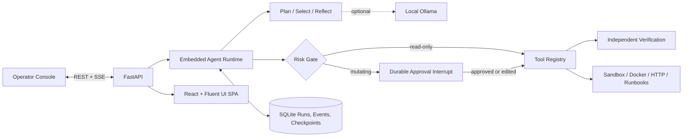

# SRE Copilot

SRE Copilot is an autonomous incident-triage and remediation application for local platform
engineering workflows. It plans an investigation, calls diagnostic tools, records evidence,
proposes a bounded remediation, waits for operator approval before making changes, and verifies
service recovery.

The React operator console and REST/SSE APIs are served by one FastAPI process on one port.
Run state, events, approvals, and checkpoints are persisted in SQLite so incidents can survive a
process restart.

## Features

- Explicit scope → evidence → diagnosis → remediation → verification workflow
- Durable SQLite state, append-only events, and checkpoint history
- Live Server-Sent Events timeline with reconnect and replay
- Human approval gate for every mutating tool
- Editable action arguments, plans, and operator guidance
- Retryable tool failures, bounded backoff, replanning, and hard execution budgets
- Portable `demo-api` fault scenarios that work without external infrastructure
- Optional local Ollama reasoning with a deterministic offline fallback
- Indexed runbooks and resolved-incident memory, with optional semantic retrieval
- Prompt-injection screening, secret/PII redaction, and outbound/tool governance
- Optional token-based viewer, operator, and approver access with browser sessions
- React 18, TypeScript, Vite, and Fluent UI operator console
- Single-container Docker deployment

## Choose a startup method

| Method | Best for | Open |
|---|---|---|
| Docker Compose | Fastest complete setup | `http://localhost:8000` |
| Native production build | Running everything without Docker | `http://localhost:8000` |
| Development mode | Backend and UI hot reload | `http://localhost:5173` |

## Option 1: Start with Docker Compose

### Prerequisites

- Docker Engine or Docker Desktop
- Docker Compose v2 (`docker compose version`)

### Start the application

From the repository root:

```bash
docker compose up --build -d
docker compose ps
```

Wait for the `sre-copilot` container to become healthy, then open:

- Operator console: `http://localhost:8000`
- API documentation: `http://localhost:8000/api/docs`
- Health endpoint: `http://localhost:8000/health`

Check the application from a terminal:

```bash
curl --fail http://localhost:8000/health
curl --fail http://localhost:8000/api/health
```

### Select a demo incident

The repository starts with a database-down scenario. You can reset or change it from inside the
running container:

```bash
docker compose exec sre-copilot python sandbox/chaos.py db-down
docker compose exec sre-copilot python sandbox/chaos.py bad-config
docker compose exec sre-copilot python sandbox/chaos.py latency
docker compose exec sre-copilot python sandbox/chaos.py healthy
```

Create an incident in the UI with service name **`demo-api`**.

### View logs and stop

```bash
docker compose logs -f sre-copilot
docker compose down
```

To also remove the persisted SQLite volume:

```bash
docker compose down -v
```

### Docker socket permission on Linux or WSL

If Docker reports `permission denied while trying to connect to the docker API`, add your user to
the Docker group, then fully sign out and back in:

```bash
sudo usermod -aG docker "$USER"
```

After starting a new login session, verify access:

```bash
docker version
docker compose version
```

On WSL with Docker Desktop, also enable WSL integration for the distribution in Docker Desktop
settings.

## Option 2: Start natively

### Prerequisites

- Python 3.11 or newer
- Node.js 20 or newer
- npm 9 or newer

### 1. Create and activate a virtual environment

Linux, macOS, or WSL:

```bash
python3 -m venv .venv
source .venv/bin/activate
```

Windows PowerShell:

```powershell
py -3.12 -m venv .venv
.\.venv\Scripts\Activate.ps1
```

If Ubuntu or WSL reports that `ensurepip` is unavailable:

```bash
sudo apt update
sudo apt install python3-venv
```

### 2. Install the backend

```bash
python -m pip install --upgrade pip
python -m pip install -e ".[dev]"
```

### 3. Install and build the UI

```bash
cd ui
npm ci
npm run build
cd ..
```

The production SPA is written to `ui/dist`. FastAPI serves that directory at `/`.

### 4. Configure the application

Linux, macOS, or WSL:

```bash
cp .env.example .env
```

Windows PowerShell:

```powershell
Copy-Item .env.example .env
```

The defaults work for the included sandbox. Important settings:

| Variable | Default | Purpose |
|---|---|---|
| `PORT` | `8000` | FastAPI and UI port |
| `DATABASE_PATH` | `data/sre-copilot.db` | Durable SQLite database |
| `SANDBOX_STATE_PATH` | `sandbox/runtime/state.json` | Portable incident state |
| `LLM_MODE` | `auto` | `auto`, `ollama`, or `deterministic` |
| `OLLAMA_MODEL` | `qwen2.5:7b-instruct` | Local model name |
| `MAX_STEPS` | `12` | Per-run autonomous step budget |
| `MAX_TOOL_CALLS` | `24` | Per-run tool-call budget |

### 5. Seed a scenario and start FastAPI

```bash
python sandbox/chaos.py db-down
uvicorn sre_copilot.app:app --reload --host 0.0.0.0 --port 8000
```

Open `http://localhost:8000`.

## Option 3: Development mode with UI hot reload

Install the native dependencies first, then use two terminals.

Terminal 1 — FastAPI:

```bash
uvicorn sre_copilot.app:app --reload --host 0.0.0.0 --port 8000
```

Terminal 2 — Vite:

```bash
cd ui
npm run dev
```

Open `http://localhost:5173`. Vite proxies `/api` requests to FastAPI on port `8000`.

Before testing the production hosting path, rebuild and open port `8000`:

```bash
cd ui
npm run build
```

## Ollama configuration

Ollama is optional. `LLM_MODE=auto` attempts to use Ollama and falls back to the deterministic
incident policy if the model server is unavailable. Approval, risk, budget, and verification rules
are enforced by the runtime in both modes.

Install and start Ollama, then pull the configured model:

```bash
ollama pull qwen2.5:7b-instruct
ollama serve
```

Native execution uses:

```env
OLLAMA_BASE_URL=http://127.0.0.1:11434
LLM_MODE=auto
```

Docker Compose reaches host Ollama through:

```env
DOCKER_OLLAMA_BASE_URL=http://host.docker.internal:11434
```

To run without any model dependency:

```env
LLM_MODE=deterministic
```

## Knowledge and incident memory

At startup, the application indexes local runbooks and resolved incidents in SQLite FTS5.
Resolved runs are added automatically. Retrieval returns ranked chunks with source identifiers
and supplies previous incident context to the investigation; it does not automatically apply
previous fixes or train the model.

The operator console includes a knowledge search panel. Use **Refresh index** after changing
runbooks; reindexing removes deleted runbooks and replaces changed content. The index shares
the existing SQLite database and Docker data volume.

Full-text search works offline. To enable hybrid full-text and semantic search:

```bash
ollama pull nomic-embed-text
```

`LLM_MODE=deterministic` disables model-based diagnosis. Leave `KNOWLEDGE_EMBEDDING_MODEL`
empty as well when no model requests should be made.

Set `KNOWLEDGE_EMBEDDING_MODEL=nomic-embed-text` in `.env`, then restart the application or
recreate the Compose service. Embeddings are cached by content and model; changing the model
requires reindexing. If embedding generation fails, search falls back to full-text retrieval
with an explicit warning in the API and UI. No embedding model is downloaded automatically.
After an embedding failure, refresh the index to retry the model instead of repeatedly
calling an unavailable endpoint.

Runbooks are screened and redacted before indexing or embedding. Suspicious documents are
quarantined; symlinks and files larger than 256 KB are skipped. Index capacity and chunk size
are controlled by `KNOWLEDGE_MAX_DOCUMENTS` and `KNOWLEDGE_CHUNK_SIZE`.

## Security and workflow governance

The built-in protection layer is enforced in the runtime as well as the API:

- **Prompt-injection screening:** checks incident text, operator guidance, tool output,
  retrieved knowledge, and model responses for instruction overrides and common role-spoofing
  patterns. Unicode normalization reduces simple obfuscation. Blocked tool content is not
  passed to the model, and affected investigations stop in `needs_human`.
- **Data protection:** redacts supported secret formats, configured access tokens, credential
  assignments, email addresses, SSNs, and Luhn-valid payment-card numbers. Redaction happens
  before model/embedding requests, new snapshots, events, and knowledge records. Startup also
  scrubs existing incident snapshots, checkpoint JSON, and event JSON. Sensitive executable
  tool arguments are rejected instead of silently rewritten.
- **Execution governance:** tool arguments and model output use strict schemas. Tools and
  service targets must be allowlisted, including operator-edited approval arguments.
  A model cannot expand an incident's target. Mutations require the exact pending action ID
  and arguments; interrupted executions require operator-directed verification after restart
  rather than automatic re-execution.
- **Outbound policy:** HTTP health checks are denied by default. `ALLOWED_HTTP_ORIGINS` enables
  specific scheme/host/port combinations. Model requests use `ALLOWED_MODEL_ORIGINS`.
  Credentials in URLs, metadata/link-local IP destinations, redirects, oversized responses,
  and environment proxy inheritance are blocked.
- **Editable-plan governance (LCNC):** pause a run before editing its plan. Keep the built-in
  `scope`, `evidence`, `diagnose`, `remediate`, and `verify` stages exactly once and in that
  order. Progress cannot be forged through a plan update, and pending approvals lock the plan.
  These controls govern this application's workflows and connectors, not external Power Platform
  environments.

The default allowed service is `demo-api`. To investigate other local containers, explicitly
add their exact names to `ALLOWED_SERVICES`. `ALLOWED_TOOLS` can further restrict connectors.
For example, settings accepting lists use JSON syntax:

```env
ALLOWED_SERVICES=["demo-api","checkout-api"]
ALLOWED_HTTP_ORIGINS=["http://127.0.0.1:8001"]
```

Allowed DNS hostnames are trusted operator configuration: use trusted DNS and network-level
egress rules in deployment. Pattern screening and redaction are defense-in-depth measures,
not guarantees that every injection or sensitive-data format can be detected. Original
runbook/sandbox files, database backups/WAL remnants, and external infrastructure logs are
outside the redaction layer; protect and retire those separately.

### Enable authenticated access

Authentication is off for the local demo. Enable it before exposing the application:

```env
AUTH_ENABLED=true
AUTH_TOKENS={"<viewer-token>":"viewer","<operator-token>":"operator","<approver-token>":"approver"}
SESSION_TTL_SECONDS=3600
```

Replace each placeholder with a different random token of at least 32 characters. Generate
tokens locally, for example with `python -c "import secrets; print(secrets.token_urlsafe(32))"`.
Do not commit the resulting `.env`. Restart the native process or recreate the Compose service
after configuration changes.

| Role | Permissions |
|---|---|
| Viewer | Read incidents, event streams, knowledge, and security status/audit records |
| Operator | Viewer permissions plus create/guide/pause/resume/cancel runs, edit plans, and refresh knowledge |
| Approver | Operator permissions plus approve or reject proposed mutations |

The browser sign-in exchanges a token for a short-lived HttpOnly, SameSite-strict session
cookie. Mutating cookie-authenticated requests require a CSRF token. Access tokens are not
stored in browser storage or placed in SSE URLs. Sessions expire and are cleared on process
restart; sign out revokes the current session. Use HTTPS and `AUTH_COOKIE_SECURE=true` when
deploying beyond localhost. API clients may instead send `Authorization: Bearer <token>`.
The `/health` probe remains public.

Policy denials and authenticated operator requests are audited without storing submitted
credentials. Read policy settings at `/api/security`, audit events at `/api/security/events`,
and per-run security/redaction events in the incident timeline.

## Run the demo

1. Select a fault:

   ```bash
   python sandbox/chaos.py db-down
   ```

   When using Docker, run the equivalent `docker compose exec` command shown above.

2. Open the operator console and choose **New incident**.
3. Enter:
   - Title: `Checkout API database outage`
   - Service: `demo-api`
   - Severity: `High`
   - Description: `HTTP 503 responses and database connection failures`
4. Watch the agent collect state, logs, and runbook evidence.
5. Review the diagnosis and the pending `restore_demo_service` action.
6. Optionally add a `change_ticket` argument, then approve the action.
7. Confirm the timeline records remediation and independent health verification.
8. Open checkpoint history or restart FastAPI to verify that the completed run remains available.

Available scenarios:

```bash
python sandbox/chaos.py db-down
python sandbox/chaos.py bad-config
python sandbox/chaos.py latency
python sandbox/chaos.py healthy
```

## Validation

Backend:

```bash
python -m ruff check src tests sandbox
python -m pytest -q
```

Frontend:

```bash
cd ui
npm run typecheck
npm run build
```

Compose configuration:

```bash
docker compose config --quiet
```

Complete container check:

```bash
docker compose up --build -d
docker compose ps
curl --fail http://localhost:8000/health
curl --fail http://localhost:8000/api/health
docker compose down
```

## Architecture



### Safety and recovery rules

- Tool risk is registered in code as `read_only` or `mutating`.
- A mutating tool can run only when it matches the persisted pending action and an operator
  approves it.
- Tool exceptions become structured events instead of crashing the run.
- Retryable failures use bounded exponential backoff.
- Failed remediation and failed verification return to evidence collection.
- Step and tool-call budgets transition exhausted runs to `needs_human`.
- Timeline reasoning is a concise operational summary, not hidden model chain-of-thought.

## API endpoints

| Method | Endpoint | Purpose |
|---|---|---|
| `POST` | `/api/runs` | Start an incident run |
| `GET` | `/api/runs` | List runs |
| `GET` | `/api/runs/{id}` | Read current durable state |
| `GET` | `/api/runs/{id}/events` | Replay and stream SSE events |
| `GET` | `/api/runs/{id}/history` | List checkpoints |
| `POST` | `/api/runs/{id}/approve` | Approve and optionally edit an action |
| `POST` | `/api/runs/{id}/reject` | Reject an action |
| `POST` | `/api/runs/{id}/guide` | Add operator guidance |
| `POST` | `/api/runs/{id}/pause` | Pause automation |
| `POST` | `/api/runs/{id}/resume` | Resume a run |
| `POST` | `/api/runs/{id}/cancel` | Cancel a run |
| `PATCH` | `/api/runs/{id}/plan` | Edit or reorder the plan |
| `GET` | `/api/tools` | List tools, schemas, and risk levels |
| `GET` | `/api/health` | Agent runtime readiness |
| `GET` | `/health` | Process health |
| `GET/POST/DELETE` | `/api/auth/session` | Inspect, create, or revoke a browser session |
| `GET` | `/api/knowledge` | Index status and warnings |
| `GET` | `/api/knowledge/search?query=...` | Ranked runbook and incident retrieval |
| `POST` | `/api/knowledge/search` | Search with a JSON body (used by the UI to keep queries out of access-log URLs) |
| `POST` | `/api/knowledge/reindex` | Refresh runbooks and resolved-incident memory |
| `GET` | `/api/security` | Effective protection and governance settings |
| `GET` | `/api/security/events` | Recent authentication and policy audit records |

## Repository layout

```text
src/sre_copilot/   FastAPI app, runtime, persistence, tools, and Ollama client
ui/                React, TypeScript, Vite, and Fluent UI operator console
sandbox/           Portable fault state, scenario controller, and demo API
runbooks/          Local operational procedures searched by the agent
tests/             Runtime persistence, approval, recovery, and API tests
ai-log/            AI-assisted implementation record
Dockerfile         Multi-stage UI and Python production image
docker-compose.yml Single-container local deployment
```

## Troubleshooting

### The root page says the UI is not built

```bash
cd ui
npm ci
npm run build
```

Restart FastAPI after the build completes.

### A run immediately reports missing sandbox state

```bash
python sandbox/chaos.py db-down
```

For Docker:

```bash
docker compose exec sre-copilot python sandbox/chaos.py db-down
```

### Ollama is unavailable

Confirm `ollama serve` is running and the configured model is installed, or set:

```env
LLM_MODE=deterministic
```

### Port 8000 is already in use

Native:

```bash
uvicorn sre_copilot.app:app --reload --port 8081
```

Docker:

```bash
PORT=8081 docker compose up --build -d
```

Then open `http://localhost:8081`.

## Current limitations

- Authentication is opt-in and uses configured local tokens, not enterprise SSO or tenant isolation.
- SQLite targets a single application replica.
- Production infrastructure tools need workload identity and narrower authorization policies.
- Model and remediation expansion should be gated by scenario replay evaluations.
- Enterprise DLP connectors, automated retention, and organization-specific data classifiers
  require separate deployment integration.

## AI-assisted implementation record

The `ai-log/` directory records the supplied assessment, implementation decisions, validation
commands, and known limitations. It intentionally excludes private chain-of-thought and secrets.
